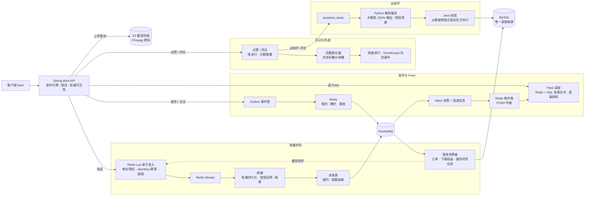

# Content：创作者素材社区

创作者在这里发布视频素材，读者关注、点赞、评论、按话题发现内容；作者可以发起素材限量抢购和抽奖，在评论里 @助手 就能用自然语言订阅反馈或发起抽奖。

后端是 Java 17 + Spring Boot 3 + MyBatis 的模块化单体，使用 MySQL 8.4、Redis 7.4、RocketMQ 5.3 和 S3 兼容对象存储；前端是 Nuxt；@助手 的意图解析是一个独立的 Python 服务（大模型，规则版兜底）。

> 本项目的重点是**高并发下的正确性**和**可复现的工程证据**：每个行为改动先写失败测试再实现，每个性能结论都有原始数据和报告。下面所有数字都来自仓库内的报告，并注明了测试环境。

## 架构



`api` 是 HTTP 适配层，`domain` 是业务规则，`infrastructure` 是数据库与中间件适配，`worker` 是异步入口。所有授权（可见性、下载权益、下架）最终都以 MySQL 为准，Redis 和消息只用来加速和解耦。

## 核心设计

- **抢购入口不碰数据库。** 一次 Lua 脚本里完成活动校验、黑名单、限购、clientKey 幂等和库存预扣，并写入 Redis Stream；桥接再批量写入 MySQL，派发后由 RocketMQ 消费者落单。Redis 丢失或数据不一致时，带代际栅栏的恢复流程从 MySQL 重建缓存，期间入口明确返回 503，不会超卖。见 [购买入口契约](docs/commerce-ingress-v2.md)、[Stream 批量桥接](docs/commerce-stream-batch.md)、[MQ 批量派发](docs/commerce-mq-dispatch-batch.md)。
- **事务内写 Outbox，至少一次投递。** 发布、关注、模式切换和下架在同一事务里写入 Outbox 事件；Relay 用租约和令牌栅栏发送，只有 `SEND_OK` 才算已发送，可审计地重放。消费端按事件身份去重，冲突事件进入冲突表，不会被静默确认。见 [Outbox Relay 协议](docs/m1-story2-outbox-relay.md)。
- **推拉混合 Feed 与关注代际。** PUSH 作者扇出到 Redis 收件箱，PULL 作者读时用 SQL 拉取，两路有界合并；每条候选再按帖子当前状态和当前关注代际授权。Redis 丢失时退回完整的 SQL 主路径，游标用 HMAC 签名。见 ADR [0001](docs/adr/0001-redis-feed-order.md)、[0002](docs/adr/0002-feed-pagination.md)、[0003](docs/adr/0003-follow-epochs.md)、[0004](docs/adr/0004-offline-visibility.md) 和 [M2/M3 交付记录](docs/m2-m3-batch.md)。
- **互动热点拆解。** 点赞事务只写账本行和计数增量，热门帖子的计数行锁只覆盖最后一条 UPDATE；话题分钟桶由后台聚合器带租约和水位异步折叠；离线对账任务修正计数漂移。同一用户对同一帖子并发点赞和点踩，原来会死锁，现在每个反应事务先锁该用户自己的行，从根上消除。见 [第 B 轮报告](docs/perf-evidence/hardening-b-20261122/README.md) 和 [加固计划 B1–B10](docs/hardening-plan.md)。
- **@助手：大模型只负责理解，Java 负责决定。** 解析服务只返回结构化命令（JSON 模式、不提供任何工具、Pydantic 严格校验，不合格就降级到规则版）；Java 在执行前从数据库独立核实目标评论、作者身份、许可范围、奖品版本、人数和时间，解析结果再怎么错都不会被执行。见 [助手说明](docs/v1.1-material-assistant.md)、[Java 端校验评测](docs/perf-evidence/assistant/a11-validation-20261121.md)、[大模型与规则版对比](docs/perf-evidence/assistant/llm-vs-rules-20261121.md)。
- **TrendGuard 风险事件。** 话题突增按确定性的事件 id 和唯一键只记一次，在聚合时检测，不阻塞互动写入。见 [ADR 0005](docs/adr/0005-trendguard-risk-events.md)、[M9 验收](docs/m9-trendguard.md)。
- **按轮次加固，留证据。** A 到 D 四轮（安全与正确性、性能热点、数据增长、测试缺口）都有问题、方案、RED/GREEN 和压测记录；指标缺少证据就标“缺证据”，不做推算。见 [加固计划](docs/hardening-plan.md)。

## 关键数据

> **测试环境**：应用、中间件（Docker Desktop，内存上限 4.8 GiB）和压测机**都在同一台 16 GB 内存的笔记本上**（i7-1260P，16 个逻辑核）。所有数字都是单机数字，彼此争抢 CPU，不代表分布式部署的能力；不同报告的方法不同，不能直接互相比较。

| 场景 | 结果 | 来源 |
|---|---|---|
| 抢购入口（售罄路径，k6 开放模型） | 阶梯到 3000/s 每级都有效：实际 2989.6/s，P99 45 ms，0 错误；上限没有测到，3000/s 时整机 CPU P95 已达 99% | [入口 QPS 报告](docs/perf-evidence/commerce/ingress-qps-20261120.md) |
| 抢购落单（单活动，60/s × 60 s） | 全程成交约 28 单/秒（瓶颈是单活动热点行提交）；入口 HTTP P95 14–15 ms；逐笔对账、重放、孤儿引用检查全部通过 | [落单对照报告](docs/perf-evidence/commerce/campaign-lock-v26-clean-20261120.md) |
| 抢购集中突发（1000 / 5000 人，库存 100） | 正确性通过：恰好 100 笔已付订单、100 份权益，其余都是真实售罄；5000 人时 P95 41 s，**不能算低延迟** | [秒杀验收报告](docs/perf-evidence/commerce/flash-sale-final-20261118-024645.md) |
| 互动（4 个热门帖子，200 rps 目标） | 加固前达成约 88 rps、伴随 5xx；第 B 轮后 166–180 rps、无 5xx；新上限在热门帖子的计数行 | [第 B 轮报告](docs/perf-evidence/hardening-b-20261122/README.md) |
| 点赞的计数部分（100 万赞的帖子） | 69.4 ms → 0.07 ms（不再每次 COUNT） | 同上 |
| 抢购缓存同步（进程内真实 Broker） | 空闲提交 17.4 → 1.1 次/秒；负载下每单提交约 3.76 → 2.42 | 同上 |
| 推模式扩散 | 约 1000 粉丝/秒，与粉丝数线性（10 万粉丝 95 s 全部可见），优化已立项 | 同上 |
| 登录（bcrypt 有界线程池） | 200 rps 下：改前丢弃 2079 次迭代、p99 5.0 s；改后无丢弃、无 5xx，p99 1.5 s | [第 A 轮报告](docs/perf-evidence/hardening-a-20261121/README.md) |

**@助手 评测**（281 条标注（由 AI 生成，人工抽检 30 条），开发 197 / 测试 84；对外以测试集为准）：

| 指标（测试集） | 大模型版 | 规则版 |
|---|---|---|
| 意图准确率 / 宏 F1 | 98.8% / 0.983 | 82.1% / 0.671 |
| 执行判定准确率 | 97.6% | 60.7% |
| 抽奖全字段准确率 | 100% | 0%（解析不了自然语言时间） |
| 端到端非法执行 | 0 | 0 |
| 注入集（26 条）被执行 | 0 | — |
| 延迟 P50 / P95 | 1.34 s / 1.72 s | — |

Java 端校验加入前后，全量 281 条的端到端非法执行从 10 降到 0，冒烟集 171 条从 18 降到 0，可正常执行的命令一条没有误伤。数据来源：[大模型与规则版对比](docs/perf-evidence/assistant/llm-vs-rules-20261121.md)、[Java 端校验评测](docs/perf-evidence/assistant/a11-validation-20261121.md)、[评测基线](docs/perf-evidence/assistant/eval-baseline-20261121.md)。

## 测试与 CI

- **测试类型**：
  - Java 单元测试；
  - 集成测试：用 Testcontainers 启动真实的 MySQL 8.4、Redis 7.4、RocketMQ 5.3.2 和 S3 替身，覆盖事务、并发竞态、故障注入（独立 JVM 强杀、Broker 暂停、Redis 重启）和恢复流程；
  - Python 解析服务的 pytest；
  - 前端的 Vitest 和类型检查。
- **数量**（CI run `44983220082`）：
  - Java 单元 68 个；
  - 集成测试分两个分片：a-l 336 个、m-z 178 个，其中需要真实 Broker 或手动开启的用例在这两个分片里跳过；
  - 真实 RocketMQ 105 个；
  - Python 151 个，前端 21 个。
- **CI 的 5 个并行 job**（`.github/workflows/ci.yml`，每个不超过 35 分钟，超时就拆分，不调大超时）：
  - `maven (a-l)`、`maven (m-z)`：单元测试加按类名分片的集成测试；
  - `maven-real-mq`：真实 RocketMQ 的抢购派发与落单；
  - `frontend`：类型检查加 Vitest；
  - `assistant-python`：pytest。
- **不进 CI 的**：压测和测量工具（`PerfHarnessIT`、`FanoutMeasureIT`、`CommerceSyncPerfIT`）、需要真实 MinIO 镜像的 `MediaMinioIT`，以及需要标注数据的 `AssistantEvalE2EIT`。
- 本地分批运行集成测试：`python infra/test/run_it_batches.py --out <新目录> --per-batch 2`（每批开始前检查可用内存）。

## 本地运行

需要 Windows + PowerShell、JDK 17、Maven（仓库自带 `tools/apache-maven-3.9.6`）、Docker Desktop；前端另需 Node 20+ 和 pnpm，@助手 需要 Python 3。

```powershell
# 1. 中间件：MySQL、Redis、RocketMQ（首次先复制 .env 并填好密码）
Copy-Item infra/docker/.env.example infra/docker/.env
.\infra\docker\start.ps1
.\infra\docker\create-relay-topic.ps1; .\infra\docker\create-sale-topic.ps1

# 2. 后端（端口 28080）。两个签名密钥各至少 32 字节，不要提交到 Git
$env:CONTENT_MYSQL_PASSWORD = Read-Host 'MySQL password' -MaskInput
$env:CONTENT_CURSOR_KEY = '<至少 32 字节>'; $env:CONTENT_IDENTITY_KEY = '<另一个至少 32 字节>'
mvn -DskipTests package
java -jar target/content-0.1.0-SNAPSHOT.jar --spring.profiles.active=pipeline

# 3. 前端（端口 5314，/api 代理到 28080）
cd frontend; pnpm install; pnpm dev
```

- **@助手**：不配置时 Java 使用确定性的替身解析器。要用真实解析服务，在 `assistant-python` 下 `pip install -r requirements.txt` 并启动，然后设置 `CONTENT_ASSISTANT_PYTHON_URL` 和 `CONTENT_ASSISTANT_INTERNAL_TOKEN`；解析模式和大模型供应商见 [助手说明](docs/v1.1-material-assistant.md)。
- **测试**：`mvn -B verify` 只跑单元测试；`mvn -B -Pintegration verify` 加上集成测试（需要 Docker）。
- **演示脚本**：`infra/docker/demo-*.ps1`。端口、Redis 恢复、Outbox/任务重放等运维命令见 [开发说明](docs/development.md)。

## 已知限制

- **支付和退款是模拟实现**：没有接入任何支付渠道，不发生资金流动。订单落单即为已付；退款只改变订单和权益状态。接入真实支付前需要补齐的内容见 [支付与退款边界](docs/v1.1-material-commerce.md#支付与退款边界模拟实现)。
- **对象存储没有用官方 MinIO 验收**：官方镜像无法获取，媒体相关集成测试使用 `adobe/s3mock` 作 S3 替身；`MediaMinioIT` 需要本地自建镜像，在 CI 中跳过。
- **没有部署与高可用**：单机 Redis（非 Cluster）、单 Broker 异步刷盘无副本、单实例应用；没有部署脚本、容量规划落地和监控告警，生产环境的 Redis maxmemory 与告警也需要另行配置。
- **所有性能数字都是单机数字**，见上文的环境说明。
- **已知性能边界（已立项，未实现）**，见 [加固计划](docs/hardening-plan.md)：
  - 一个作者的关注在作者行上串行，约 26–31 次/秒（B7）；
  - 推模式扩散约 1000 粉丝/秒（B8）；
  - 热门帖子的计数行约 40–45 次/秒/帖（B9）；
  - 抢购的 Redis 状态随历史请求总数增长（C3，设计待确认）。
- FFmpeg 在容器尚未创建时就超时，存在理论上的清理窗口（容器创建后超时或中断都会 `docker rm -f`）。
